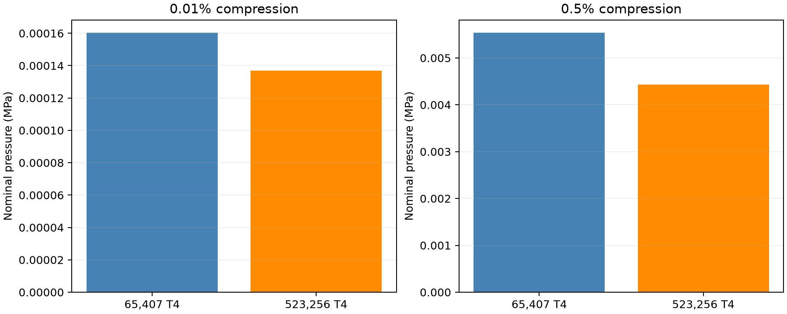
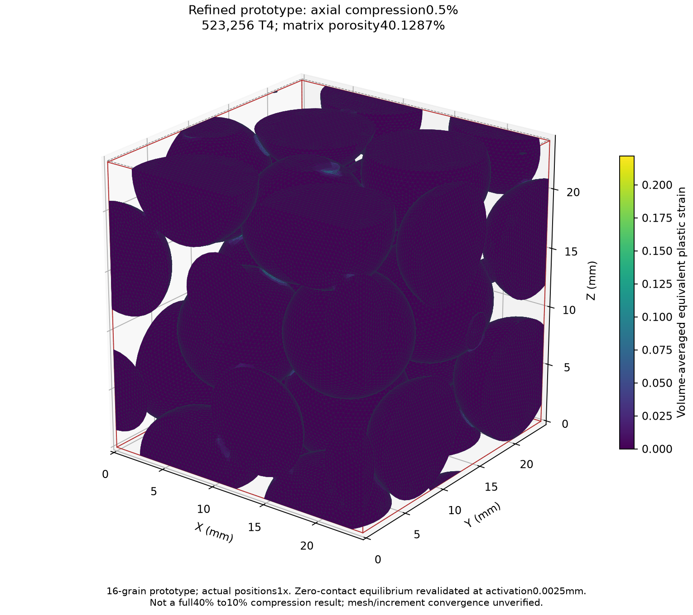
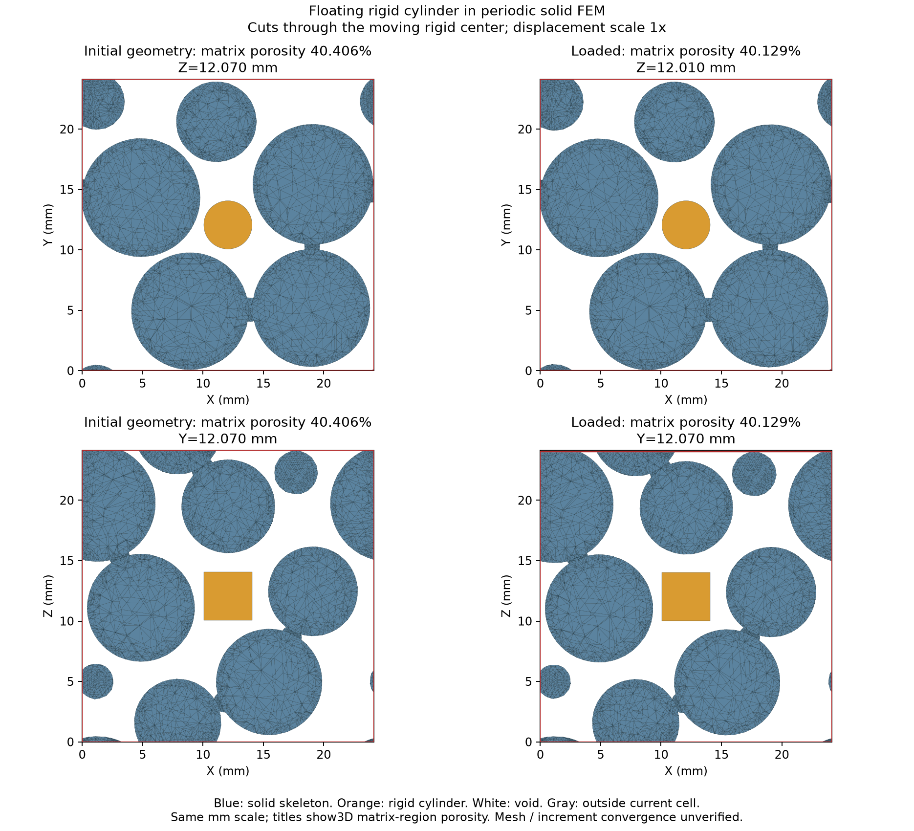
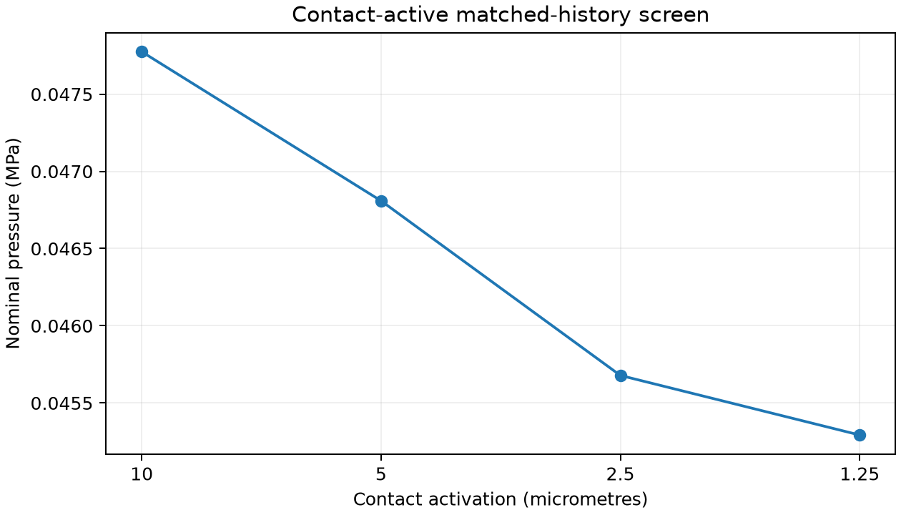

# 初期接触・要素分割の修正済み試験モデル

**初期予荷重による不要な塑性を除去し、同じ表面形状・骨格基準体積を保つ8分割を圧縮計算へ接続しました。** 接触活性幅は局所感度比較を経て0.0025 mmを試験用設定に選びました。修正モデルで空隙率40%→10%の全経路を再計算した結果ではなく、メッシュ・荷重刻み収束の認定もまだ行っていません。

対象は16粒子D10 mm・焼結ネックD2 mm、周期セル24.1407 mm角、自由6DOF円柱D4/H4 mm。E10 MPa、ν0.33、J2降伏0.05 MPa・硬化0.2 MPa、摩擦0.3を維持しました。降伏・硬化は未校正の試験値です。横周期寸法と全マクロせん断を固定し、周期微視変位は自由です。100 mm角・円柱D20/H20 mmの本番系ではありません。

## 変更したプログラム

- 処理開始前に、未変形・応力ゼロの材料へ接触バリアが予荷重を与えていないか検査します。旧0.02 mm設定の実メッシュは、載荷・履歴更新前に拒否されました。[拒否検査](guard-rejection.json)。
- 初期状態からの再開、および材料がまだ未変形の再メッシュにも同じ検査を適用。予荷重を導入する再メッシュは採用せず元の状態を保持します。塑性ひずみをリセットする修正は行っていません。
- 一次四面体を適合する8要素へ分割する入力準備処理を追加。入力メッシュのSHAを設定へ結び付け、粗いメッシュや別系統の再開状態への取り違えを防ぎます。再メッシュ後の再開は元の設定ファイルの出自も確認します。
- 旧設定・旧結果は再現用として保持しています。新しい推奨経路は下記の修正済み設定を使用します。

## 初期塑性の除去と細分化後の圧縮

前回、最細228,406 T4の0.01%圧縮で発生していた最大相当塑性ひずみ0.05255は、活性幅0.005 mmにした同じメッシュで0になりました。初期接触力・接触エネルギーも0です。細分化した523,256 T4でも0.01%圧縮時の塑性は0でした。採用候補0.0025 mmでも、この細分化メッシュの初期状態と収束状態を独立再評価し、予荷重ゼロと釣合いを確認しました。

| 同じ表面形状のメッシュ | 0.01%圧縮の圧力 MPa | 単一増分0.5%圧縮の圧力 MPa |
|---|---:|---:|
| 元の65,407 T4 | 0.000160276 | 0.00553614 |
| 細分化523,256 T4 | 0.000136770 | 0.00443468 |

低荷重で14.67%、0.5%圧縮で19.90%低下しました。骨格基準体積8354.169219 mm³、面形状・表面積は維持しています。材料値を下げて圧力を合わせたものではありません。0.5%圧縮時には最大相当塑性ひずみ0.2219が残っており、荷重による本来の塑性は計算しています。



このメッシュ比較は活性幅0.005 mmで非線形計算し、接触がないことを確認しました。同じ保存状態を0.0025 mmでも独立再評価し、材料・幾何・履歴を変更せず釣合いが保たれることを確認しています。この再評価2ケースを新たな非線形載荷計算としては数えていません。細分化1段階だけでメッシュ収束したという判定ではありません。[集約判定](assessment.json)・[数値CSV](comparison.csv)。





実節点位置・変位倍率1倍です。断面の橙色が剛体、青が骨格、白が空隙です。画像は0.5%圧縮の試験で、空隙率10%の最終状態ではありません。この初期区間では剛体との接触はなく、剛体影響の定量比較には使用しません。

## 接触が働く区間での活性幅感度

同じ受理済み材料履歴（充填層領域の空隙率24.935%）から、同じ軸圧縮率20.980646%へ1増分で進めました。材料・摩擦・境界・力の合格基準は共通です。各条件とも骨格の自己接触と剛体接触があり、元の各条件の接触式で独立再計算した力・世界座標の剛体釣合い・Coulomb条件・履歴・体積・非交差監査に合格しています。

| 活性幅 mm | 圧力 MPa | 充填層領域の空隙率 % |
|---:|---:|---:|
| 0.01000 | 0.0477747 | 24.80608 |
| 0.00500 | 0.0468091 | 24.80107 |
| **0.00250** | **0.0456784** | **24.79335** |
| 0.00125 | 0.0452925 | 24.79074 |

当初の0.01→0.005→0.0025 mmは圧力の隣接差2.06%→2.48%が縮小せず**未合格**でした。基準を緩めず、追加した0.005→0.0025→0.00125 mmの比較で2.48%→0.85%に減少。空隙率差も減少し、既定の圧力差5%・空隙率差0.005以内という局所スクリーニング条件を満たしました。採用する0.0025 mmとさらに細かい条件との差を確認した結果です。これは誤差上限の保証や、全経路の収束証明ではありません。[当初計画](original-plan.json)・[追加計画](extended-plan.json)。



これらは旧0.02 mm条件で受理された履歴からの局所比較で、各活性幅で未変形から全圧縮経路を解き直したものではありません。細かい条件の初期推定には既知の解の節点位置だけを用い、塑性・弾性履歴は共通の受理状態から計算しました。細分化メッシュでの深い圧縮・接触中の再メッシュ・全経路比較は次の工程です。

採用活性幅の接触中の旧メッシュ区間では、周期像27→125個の力・エネルギー・摩擦仕事の一致も確認。力の最大差は1.63e-13 Nでした。[周期像監査](periodic-audit.json)。

## 修正済み設定と入力メッシュ

[修正済みモデル設定](repaired-model-config.json)と[対応する523,256 T4の入力メッシュ](repaired-reference-mesh.npz)は、そのまま組み合わせて使用できます。設定内のSHAとファイル内容は照合済みです。依存関係を導入済みのPython環境から、新しい出力先を指定します。

```bash
PYTHONPATH=. OPENBLAS_NUM_THREADS=1 OMP_NUM_THREADS=1 MKL_NUM_THREADS=4 \
python tools/run_frozen_compaction.py \
  --config exports/rigid-contact-mesh-repair-001/repaired-model-config.json \
  --mesh exports/rigid-contact-mesh-repair-001/repaired-reference-mesh.npz \
  --out results/new-repaired-full-compaction
```

これは全圧縮経路を新規実行するコマンドで、今回実行済みの結果を示すものではありません。保持・除荷を含まない載荷専用の試験設定です。

入力を自分で準備する場合は、[元のメッシュ](original-reference-mesh.npz)と[修正用の基礎設定](../../configs/rigid-repaired-prototype-base.json)から生成します。基礎設定を直接ソルバーへ渡すと、準備済みメッシュがないため拒否します。

```bash
python tools/prepare_refined_compaction.py \
  --mesh exports/rigid-contact-mesh-repair-001/original-reference-mesh.npz \
  --config configs/rigid-repaired-prototype-base.json \
  --out results/new-prepared-model
```

生成された`config.json`と`mesh.npz`を組み合わせます。[入力準備の検査](mesh-preparation.json)。

## 検証と残る作業

[関連184テストが合格](tests-184.log)。初期予荷重、未変形での再開、再メッシュでの予荷重導入を防ぐ処理、粗いメッシュの再開による取り違えの拒否、体積・境界保存、解析解、既存の有限変形・履歴・周期条件を含みます。12ケースの載荷計算と独立監査が完了し、接触のない2ケースは採用設定で追加再評価しました。[実行記録](execution-summary.json)。

別の数値探索経路2件は、同じ条件で独立監査済みの解が得られた後に重複計算として停止しました。未収束配置を解に含めていません。停止は非収束の証明ではなく、入力・途中配置・理由を保持しています。[停止記録](intentional-interruptions.json)。旧設定の初期予荷重拒否、およびテスト作成時の失敗ログも全保存データに含めています。

**全40%→10%経路の再計算、3段階のメッシュ・荷重刻み収束、細分化メッシュで接触中の再メッシュ検証は未完了です。** 剛体なしとの同条件比較、本番100 mm系も未実施です。旧設定での[空隙率10%到達結果](../rigid-recovery-loaded-001/README.md)は、今回の修正設定の計算結果とは区別します。

## 実行ソースと終了済み試行の全保存データ

各tar.xzは単独で展開できます。全パートを同じ保存先へ展開します。計算は全て終了済みです。
[全ファイルSHA-256](raw-archive-files.json)・[アーカイブ検証](archive-verification.json)。

- [rigid-contact-mesh-repair-001-part-01.tar.xz](../rigid-contact-mesh-repair-001-part-01.tar.xz)
- [rigid-contact-mesh-repair-001-part-02.tar.xz](../rigid-contact-mesh-repair-001-part-02.tar.xz)
- [rigid-contact-mesh-repair-001-part-03.tar.xz](../rigid-contact-mesh-repair-001-part-03.tar.xz)
- [rigid-contact-mesh-repair-001-part-04.tar.xz](../rigid-contact-mesh-repair-001-part-04.tar.xz)
- [rigid-contact-mesh-repair-001-part-05.tar.xz](../rigid-contact-mesh-repair-001-part-05.tar.xz)
- [rigid-contact-mesh-repair-001-part-06.tar.xz](../rigid-contact-mesh-repair-001-part-06.tar.xz)
- [rigid-contact-mesh-repair-001-part-07.tar.xz](../rigid-contact-mesh-repair-001-part-07.tar.xz)
- [rigid-contact-mesh-repair-001-part-08.tar.xz](../rigid-contact-mesh-repair-001-part-08.tar.xz)
- [rigid-contact-mesh-repair-001-part-09.tar.xz](../rigid-contact-mesh-repair-001-part-09.tar.xz)
- [rigid-contact-mesh-repair-001-part-10.tar.xz](../rigid-contact-mesh-repair-001-part-10.tar.xz)
- [rigid-contact-mesh-repair-001-part-11.tar.xz](../rigid-contact-mesh-repair-001-part-11.tar.xz)
- [rigid-contact-mesh-repair-001-part-12.tar.xz](../rigid-contact-mesh-repair-001-part-12.tar.xz)
- [rigid-contact-mesh-repair-001-part-13.tar.xz](../rigid-contact-mesh-repair-001-part-13.tar.xz)
- [rigid-contact-mesh-repair-001-part-14.tar.xz](../rigid-contact-mesh-repair-001-part-14.tar.xz)
- [rigid-contact-mesh-repair-001-part-15.tar.xz](../rigid-contact-mesh-repair-001-part-15.tar.xz)

展開後の`source/`に実行コードと画像・CSV、`raw/`に終了済み計算の入力・保存状態・不採用試行が入っています。元の相対パスを復元する場合は、`source/results/rigid-contact-mesh-repair-001/`を作成し`raw/`の内容をコピーしてから`source/`で実行します。参照する過去の保存データは対応する公開アーカイブも展開します。

配布アーカイブから別フォルダへソースと細分化モデルの保存状態を展開し、採用活性幅0.0025 mmで独立監査を再実行しました。初期・0.5%圧縮状態とも合格。[展開後の監査](portable-refined-audit.json)・[実行ログ](portable-refined-audit.log)。全圧縮経路の再計算ではありません。
