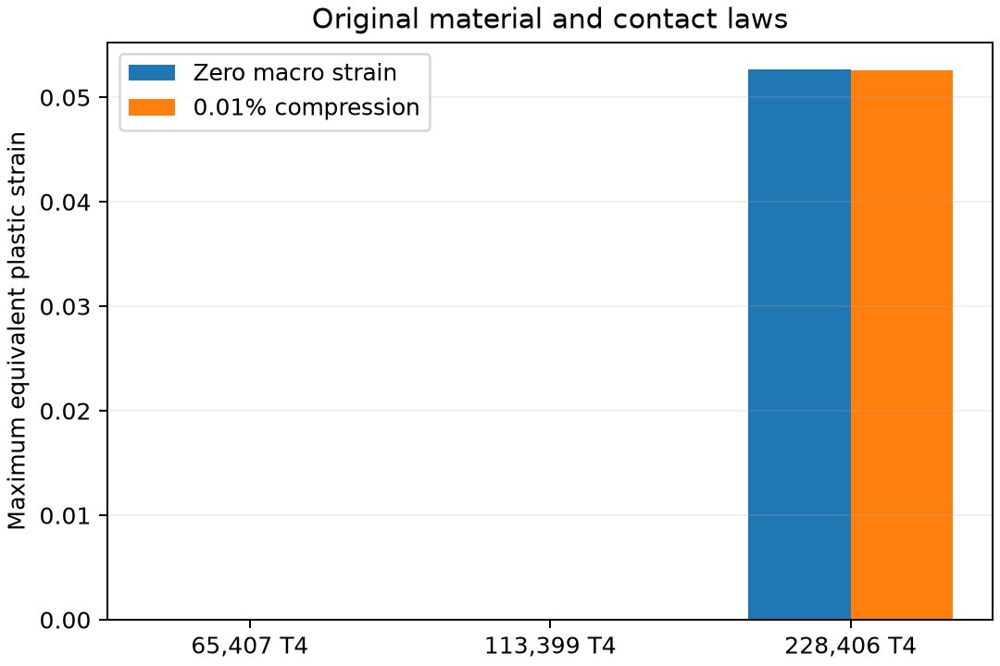
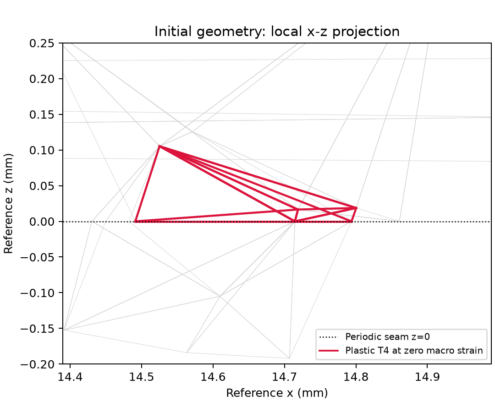
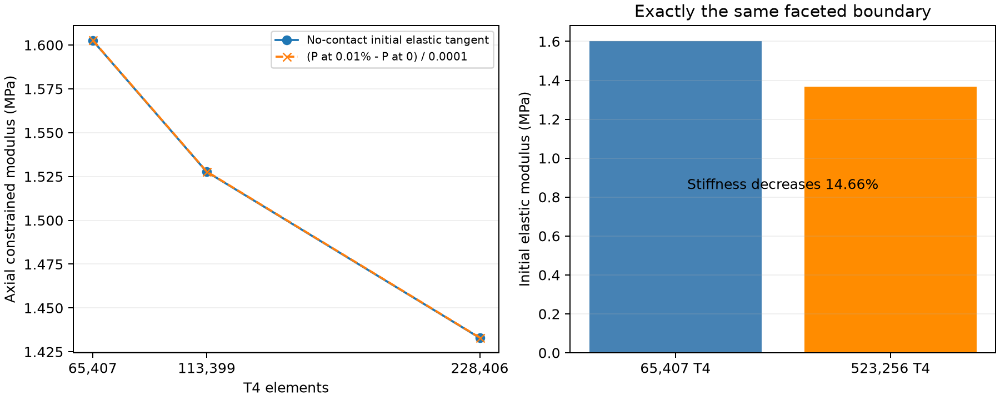

# 剛体入り充填層：初期塑性とメッシュ依存性の原因確認

原因を二つに分けて確認しました。**初期接触バリアが局所塑性を発生させること**と、**固体の一次四面体の粗い分割が初期弾性剛性を過大に評価すること**です。要素ロッキングという特定の機構までは確定していません。空隙率40%→10%の全経路の収束判定は未合格のままです。

16粒子D10 mm、ネックD2 mm、セル24.1407 mm角、自由6DOF円柱D4/H4 mmの試験系です。E10 MPa、ν0.33、降伏0.05 MPa、硬化0.2 MPa、摩擦0.3、横周期寸法固定を維持しました。100 mm角・円柱D20/H20 mmの本番系ではありません。[以前の圧縮到達結果](../rigid-recovery-loaded-001/README.md)・[前回の工程4](../rigid-stage4-accuracy-001/README.md)。

## 1. 軸圧縮ゼロでも同じ場所が塑性化する

元の材料・摩擦・接触条件を用い、全6マクロひずみをゼロに固定して緩和しました。周期微視変位と剛体6DOFは自由です。これはゼロ応力の条件ではなく、反力は残ります。材料履歴は各試験とも未変形・塑性ひずみゼロから開始し、探索中は更新せず、収束状態で一度だけ更新しました。

| 元のT4数 | 初期接触力の最大自由度成分 N | ゼロひずみ緩和の最大相当塑性ひずみ | 0.01%圧縮の最大相当塑性ひずみ |
|---:|---:|---:|---:|
| 65,407 | 0.007432 | 0 | 0 |
| 113,399 | 0.004929 | 0 | 0 |
| 228,406 | 0.185915 | 0.0526553 | 0.0525548 |

最細ではゼロひずみで3要素が塑性化し、0.01%圧縮で塑性化した2要素を両方含みました。最大塑性ひずみの要素は同じ177942で、初期最大接触力の周期節点クラスと接しています。重心は約(14.6898, 9.5505, 0.0351) mm。ゼロひずみで塑性化した骨格基準体積比は1.07851e-7で、ごく局所的な現象です。

図は初期座標のx-z投影です。赤はゼロひずみで塑性化した四面体、灰色は近傍要素、点線z=0は周期の継ぎ目で、物理的な壁ではありません。変形倍率を掛けた図ではありません。

接触を除いたゼロひずみ材料評価では、最大塑性ひずみ0、材料力は丸め誤差の約2e-14 Nでした。全マクロひずみゼロ・同じ初期材料履歴から、接触を含めた時だけ局所塑性が生じるため、初期バリアが駆動源と確認できます。初期接触13ステンシルは全て充填層表面同士で、円柱との接触はありません。幾何ギャップ約0.01739～0.01993 mmは正ですが、活性幅0.02 mm内なのでIPCバリアが働きます。[接触形状と符号付き重み](initial-stencils.json)。

全3ケースで元の物理設定による力・剛体釣合い・履歴・体積・非交差の独立監査に合格しました。これらの初期緩和状態を本番圧縮経路の初期状態へ採用したわけではありません。

## 2. 接触・塑性を除いても、要素分割だけで剛性が変わる

別の診断として、同じ材料の初期弾性接線を使用し、接触・塑性履歴更新を含めない微小変形問題を解きました。これは構成要因を分離する試験で、元の圧密モデルを接触なしへ変更したものではありません。横方向は同じ周期寸法固定で、公称圧力／軸ひずみに対応するC33を求めています。

| T4数 | 初期弾性C33 MPa |
|---:|---:|
| 65,407 | 1.602573 |
| 113,399 | 1.527687 |
| 228,406 | 1.432944 |

最粗／最細差は11.8378%。したがって、初期メッシュ差を発生させるために摩擦や塑性は必要ありません。元の接触あり計算について、同じ未変形履歴からの0.01%圧縮とゼロひずみ緩和の圧力差を0.0001で割ると、この弾性接線と各メッシュで0.012%以内に一致しました。これは二つの対照計算のスカラー圧力差であり、履歴を差し引いたり、初期緩和後の載荷経路を計算したものではありません。

さらに最粗メッシュの**表面形状と骨格体積を保ち、各四面体を8分割**しました。65,407→523,256 T4でC33は1.602573→1.367566 MPa、**14.6644%低下**しました。骨格基準体積は両方8354.169219 mm³で同一です。粗い解を細分化メッシュへ補間したエネルギーの相対差1.45e-11、反力とエネルギーの整合、自由度残差も検査しました。

同じ面形状のまま剛性が低下したため、CAD曲面の近似誤差だけでは説明できず、一次四面体の分割不足が剛性過大評価に関与することを確認できました。523,256 T4で収束したとは判定していません。また、この14.66%をそのまま空隙率10%終点の圧力誤差と解釈することはできません。[数値CSV](comparison.csv)・[弾性診断](elastic.json)・[集約判定](assessment.json)。

## 次の修正対象

初期接触は、活性幅と初期ギャップの整合を確認し、正則化の感度比較を行ってから採用条件を決めます。固体側は要素分割の改善を優先し、表面近似の変更と要素の近似精度を分けて比較します。その後、接触を含む40%→10%の全経路でメッシュ・荷重刻み収束を確認します。今回、材料値・摩擦・周期境界・本番用の接触パラメータは変更していません。

## 検証と保存

[関連36テスト](tests.log)と[均質固体の拘束弾性率の解析解テスト](analytic-tests.log)の計37件が合格。8分割の体積・共有面・境界面積保存、均質固体で細分化前後とも解析解を再現することを含みます。ゼロひずみと弾性診断は別々にソースを固定して実行し、両スナップショットのSHA不変と正常終了を確認しました。[実行検査](execution-verification.json)。

接触の個別ステンシルへの力分解は整合検査を通らなかったため、原因判定には使用していません。失敗ログは全保存データに保持しました。今回の判定は接触集合全体の力、収束状態の独立再計算、および幾何・エネルギーを保存した対照計算に基づきます。

## 実行ソースと終了済み試行の全保存データ

各tar.xzは単独で展開できます。全パートを同じ保存先へ展開します。計算は全て終了済みです。
[全ファイルSHA-256](raw-archive-files.json)・[アーカイブ検証](archive-verification.json)。

- [rigid-initial-cause-001-part-01.tar.xz](../rigid-initial-cause-001-part-01.tar.xz)
- [rigid-initial-cause-001-part-02.tar.xz](../rigid-initial-cause-001-part-02.tar.xz)
- [rigid-initial-cause-001-part-03.tar.xz](../rigid-initial-cause-001-part-03.tar.xz)

展開後の`source/`に実行コードと画像・CSV、`raw/`に終了済み計算の入力・保存状態・不採用試行が入っています。元の相対パスを復元する場合は、`source/results/rigid-initial-cause-001/`を作成し`raw/`の内容をコピーしてから`source/`で実行します。参照する過去の保存データは対応する公開アーカイブも展開します。

配布アーカイブを別フォルダへ展開し、同梱ソースと保存状態だけで最細のゼロひずみ状態を独立再監査しました。[再監査JSON](portable-zero-strain-audit.json)・[実行ログ](portable-zero-strain-audit.log)。全マクロひずみゼロ、元の力・材料履歴・体積・非交差条件に合格しました。
