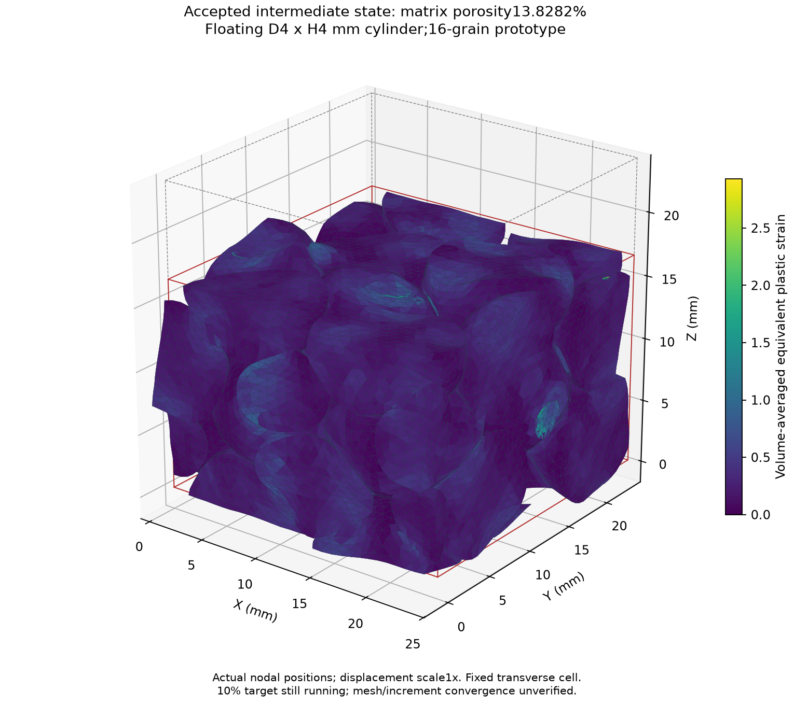

# 剛体入り圧密の途中状態：空隙率13.8282%

初期実測40.4057%→13.8282%、軸圧縮31.3556%、公称圧力0.1110506 MPa。**目標10%の完了結果ではありません。** 主計算は継続しています。

16粒子D10 mm・ネック2 mm、周期セル24.1407 mm角、自由6DOF円柱D4/H4 mmの試験モデルです。最終仕様100 mm角・円柱D20/H20 mmとは異なります。横周期寸法固定、E10 MPa、ν0.33、摩擦0.3。

[全受理経路CSV](history.csv)・[端点の原物理条件監査](endpoint-force-audit.json)・[同一荷重での探索依存性](finite-load-search-sensitivity.json)。後者は圧力差0.3522%、空隙率差0.00335ポイントで、全経路の収束を示しません。メッシュ比較は[未合格](../rigid-recovery-verification-001/README.md)です。

[現在のFEM状態](current-state.npz)・[実際の前の受理状態](previous-state.npz)・[初期メッシュ](original-mesh.npz)・[実行設定](executed-config.json)を保存しています。NPZはX/x/t/q/b/ep/V0/parentを含み、現在の画像用メッシュと材料履歴を保持します。以前の[初期形状・断面](../rigid-recovery-001/README.md)と[保存アーカイブ](../rigid-recovery-continuation-raw-002/README.md)も参照できます。

## 再開用の独立入力

GitHubの現行ソースとrequirements-parallel.txtの環境を用意し、このフォルダのファイルを同じ相対位置に保存します。出力先は新しい専用フォルダにします。resume-config.jsonは最初の数値刻みを0.005とし、任意の旧配置による予測を無効にした再開用です。実際に実行した設定はexecuted-config.jsonに別途保持しています。

```bash
PYTHONPATH=. OPENBLAS_NUM_THREADS=1 OMP_NUM_THREADS=1 MKL_NUM_THREADS=4 python tools/run_frozen_compaction.py --config exports/rigid-recovery-progress-003/resume-config.json --mesh exports/rigid-recovery-progress-003/original-mesh.npz --restart exports/rigid-recovery-progress-003/current-state.npz --out results/rigid-portable-resume-001
```

このコマンドによる再開自体は未実行です。NPZと実際の受理状態のSHA-256一致、原物理条件の力・履歴・体積・非交差監査を確認しました。初期幾何＋受理89増分の90状態について、[原物理条件の全経路監査](accepted-path-force-audit.json)も合格しました。初期形状は力釣合い判定の対象外です。



変位倍率1倍。これは途中状態の画像で、目標10%の最終結果ではありません。

## 再開処理の追加修正

直前の受理形状が同じ周期座標・要素接続を持つ場合、実際の空隙率勾配を再開直後の終点刻み制御にも引き継ぎます。材料履歴の更新には使いません。有限変形弾性スラブの解析解による再開・履歴検査を含め、[関連164件](tests-018.log)に合格しました。[並列ソルバーの終了処理4件](tests-019.log)も合格しています。これは空隙率10%の到達判定とは別です。
