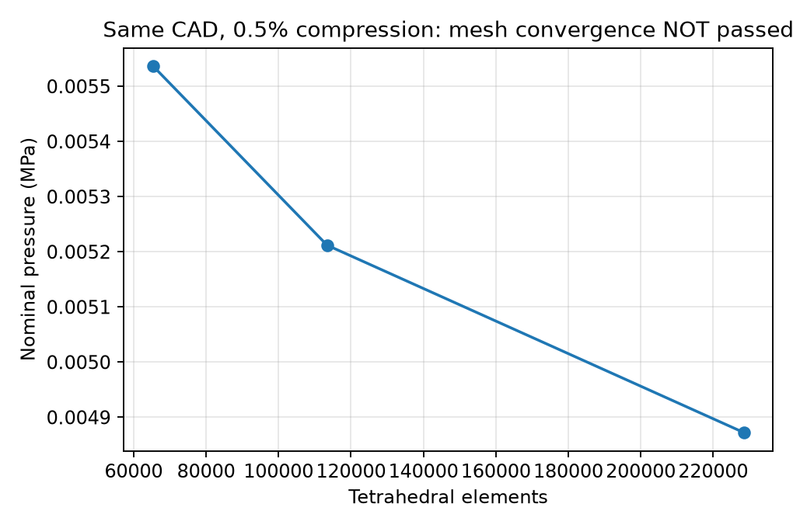

# 剛体入り圧密：工程1–4の途中検証

16粒子・粒径10 mm・ネック2 mm・周期セル24.1407 mm角、自由6DOFの円柱D4/H4 mmを用いた統合試験です。最終仕様100 mm角・円柱D20/H20 mmの計算ではありません。横方向セル寸法は固定、E10 MPa、ν0.33、摩擦0.3です。

## 実計算の進捗

初期の実測空隙率40.4057%から、原物理条件で独立監査済みの20.4982%まで到達しました。軸圧縮25.3556%、公称圧力0.0666012 MPa。目標10%の計算は継続中です。

- [受理した区間CSV](accepted-prefix-history.csv)・[原物理条件での独立監査](accepted-prefix-audit.json)
- [以前の全経路と保存データ](../rigid-recovery-001/README.md)

## 工程4の判定

同じCADの3メッシュで0.5%圧縮を完走し、各状態の力・材料履歴・形状監査は合格しました。ただし最粗／最細の圧力差は13.6256%、隣接差は6.2240%→6.9679%で縮小していません。メッシュ収束は未合格です。初期0.5%の結果であり、大変形全経路の収束を示しません。

[数値CSV](mesh-screen.csv)・[判定JSON](mesh-screen-assessment.json)。実際の入力メッシュと生成設定は元の計算フォルダに保存しています。細密ケースの未使用surface_mesh_mm値ではなく、入力NPZと生成用レシピが実際の分割を定義します。

同一の受理状態から3種類の刻みで比較した初期区間では、圧力の隣接差は0.1255%→0.0757%に縮小しました。[早期刻み比較](early-increment-sensitivity.json)。共通ひずみでのスカラー線形補間を含み、補間誤差は未評価です。40%→10%全経路の刻み収束は未確認です。

## 計算手法と検査

摩擦を固定した探索と元の連成力による補正を組み合わせる選択肢、受理履歴を一度だけ更新する処理、ソースを凍結して再開する実行補助を追加しました。探索履歴を材料履歴として扱いません。元の力基準0.005 Nと剛体の並進・回転釣合いが受理条件です。

任意のPARDISO並列線形ソルバーを追加しました。同じ55797自由度・1974159非零の実FEM行列でSuperLU29.08秒→PARDISO1.08秒、Newton方向の相対差9.01e-13でした。[計測結果](parallel-fem-benchmark.json)。これは線形代数の性能検証であり、新しい物理解の到達判定ではありません。元のSuperLUも既定として残しています。

- [関連154テスト合格](tests-016.log)：両線形ソルバーでの有限変形解析解、剛体、接触、材料、再メッシュを含む
- [環境16テスト合格](environment-tests.log)
- [監査キャッシュと元処理の一致](cached-audit-verification.json)
- [24%の途中到達を10%の最終結果として出力しない検査](milestone-export-rejection.json)

細かな検証の合格と、空隙率10%到達・全経路収束の合格は区別しています。永久変形はJ2塑性、塑性体積変化は等容ですが、弾性による現在の骨格体積変化は許容します。完全な体積不変モデルではありません。
