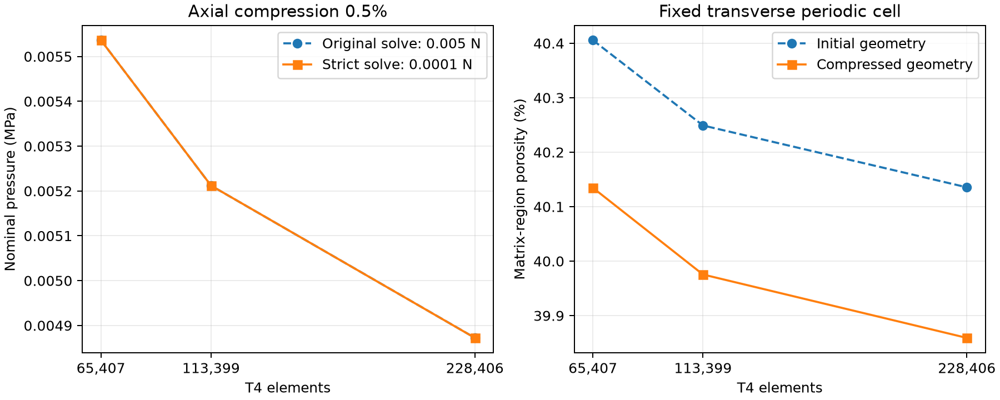
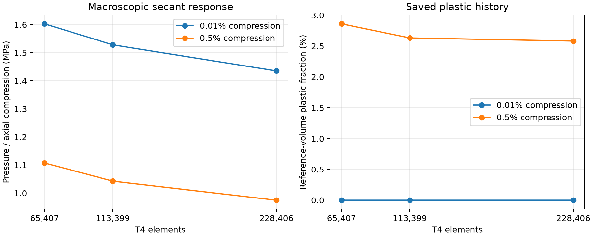

# 工程4の継続：数値探索精度・初期メッシュ依存性

16粒子D10 mm、ネックD2 mm、自由6DOF円柱D4/H4 mm、セル24.1407 mm角の統合試験です。E10 MPa、ν0.33、摩擦0.3、横周期寸法固定を維持しました。100 mm角・円柱D20/H20 mmの本番系ではありません。

**工程4は未合格です。** 以前の[空隙率40.4057%→10.0652%の到達計算](../rigid-recovery-loaded-001/README.md)を保持しています。今回の追加計算は初期0.5%と0.01%圧縮の計6ケースで、全40%→10%経路の再計算・収束認定ではありません。

## 完了した実計算

| T4要素数 | 0.5%圧縮の圧力 MPa | 厳密化による圧力差 | 0.01%圧縮の圧力 MPa |
|---:|---:|---:|---:|
| 65407 | 0.005536225872 | 0.00198% | 0.0001603000468 |
| 113399 | 0.005212008418 | 0.00122% | 0.0001528090903 |
| 228406 | 0.004872308298 | 0.00263% | 0.0001435111274 |

元の合格基準0.005 Nを維持し、0.5%圧縮では反復停止を0.0001 Nへ厳密化。内側停止値も0.0001→0.00002 Nへ変更し、同等性検証済みPARDISOを使用しました。これは複数の数値探索設定を変えた感度比較で、単一変数の誤差上限ではありません。圧力の変化は最大0.00263%ですが、最粗／最細差は13.6263%残りました。隣接差6.2206%→6.9721%は減少せず、従来の5%目安に不合格です。



[数値CSV](accuracy-comparison.csv)・[実状態SHAに結び付けた比較](accuracy-assessment.json)・[厳密化した3メッシュ判定](strict-mesh-assessment.json)。独立監査は元の物理設定で接触・摩擦・材料履歴・体積・剛体釣合い・非交差を再計算しています。

## 切り分けで分かったこと

0.01%圧縮でも最粗／最細の圧力差は11.6987%です。停止条件2e-6 Nで全3ケースの元物理監査に合格しました。ただし最細の最大相当塑性ひずみは0.0525548、塑性化した骨格基準体積比は7.05145e-8です。最粗・中間は塑性ひずみ0でした。全メッシュが弾性という比較条件は成立しておらず、『塑性化前から同じ差がある』とは断定しません。



[低荷重比較CSV](load-regimes.csv)・[履歴からの判定](load-regimes.json)。

初期形状は材料応力ゼロですが、接触バリアの局所最大力は最粗0.00743、中間0.00493、最細0.18592 Nでした。対応する初期公称圧力は9.82e-9、6.50e-9、2.24e-7 MPaで、局所力と巨視的圧力を区別します。初期形状を釣合い済み解としては扱いません。低荷重の局所塑性との因果関係は未検証です。[初期接触CSV](initial-contact.csv)・[判定](initial-contact.json)。

他の球・ネックと交差せず周期面にも掛からない40か所のネック中央断面を、四面体と平面の交差多角形から積分しました。CAD円断面π mm²に対する平均面積不足は3.4186%→1.2837%→0.9893%です。形状近似に差があることは確認できましたが、圧力差の単独原因とする証拠ではありません。[断面CSV](neck-sections.csv)・[対象と除外理由](neck-sections.json)。

## 次の開発で解消する点

まずゼロ軸ひずみでの初期緩和と接触位置を調べ、最細メッシュの局所塑性の起源を特定します。次に同じ面形状を保つ要素細分化で、CAD形状近似と固体要素の離散化の影響を分けます。採用する接触・メッシュの仕様を決めた後、40%→10%全経路で3段階の荷重刻み・メッシュ比較を実行します。ロッキングや接触バリアを唯一の原因と断定せず、物理条件の変更で差を消すことはしません。

## 検証と再現

関連179テスト合格（[32件](tests-001.log)＋[147件](tests-003.log)）。厳密停止、許容値を緩める指定の拒否、解析解付き断面積分、既存の有限変形・周期・再メッシュ・履歴・終点制御を含みます。

6ケースは実行ソースを固定し、正常終了と全ソースSHA不変を確認しました。旧比較の監査は保存状態SHAを持たないため比較から一度拒否し、旧状態をビット一致で複写して3ケース全ての元物理監査を再実行しました。[複写記録](baseline-copy-provenance.json)・[拒否記録](unbound-audit-rejection.json)。異なる旧セルの充填配置を誤って渡した断面監査も幾何整合検査が拒否し、正しい円柱用配置でやり直しました。[入力拒否記録](neck-input-rejection.json)。不採用試行も全保存データに含めています。

[集約判定](summary.json)・[実行計画](plan.json)・[低荷重計画](small-load-plan.json)。今回の拡大周期像監査は実施していません。以前の10%終点の周期像監査は以前の保存状態についての結果です。

アーカイブを展開して下記の相対パスを復元した後、最細0.5%圧縮状態の元物理監査を独立再実行できます。出力先は未使用のファイルを指定します。

```bash
PYTHONPATH=. python tools/audit_rigid_compaction.py \
  --run results/rigid-stage4-001/strict-mesh-screen-001/level-002 \
  --physics-config results/rigid-stage4-001/strict-mesh-screen-001/input/original-physics.json \
  --local-predecessors-only --out /tmp/stage4-replay.json
```

## 実行ソースと終了済み試行の全保存データ

各tar.xzは単独で展開できます。全パートを同じ保存先へ展開します。計算は全て終了済みです。
[全ファイルSHA-256](raw-archive-files.json)・[アーカイブ検証](archive-verification.json)。

- [rigid-stage4-accuracy-001-part-01.tar.xz](../rigid-stage4-accuracy-001-part-01.tar.xz)
- [rigid-stage4-accuracy-001-part-02.tar.xz](../rigid-stage4-accuracy-001-part-02.tar.xz)
- [rigid-stage4-accuracy-001-part-03.tar.xz](../rigid-stage4-accuracy-001-part-03.tar.xz)
- [rigid-stage4-accuracy-001-part-04.tar.xz](../rigid-stage4-accuracy-001-part-04.tar.xz)
- [rigid-stage4-accuracy-001-part-05.tar.xz](../rigid-stage4-accuracy-001-part-05.tar.xz)

展開後の`source/`に実行コードと画像・CSV、`raw/`に終了済み計算の入力・保存状態・不採用試行が入っています。元の相対パスを復元する場合は、`source/results/rigid-stage4-001/`を作成し`raw/`の内容をコピーしてから`source/`で実行します。参照する過去の保存データは対応する公開アーカイブも展開します。

別フォルダへ全アーカイブを展開し、同梱ソースのみをPYTHONPATHに指定して上記の最細状態監査を実行しました。初期・載荷状態とも合格しました。[展開後の独立監査](portable-replay-audit.json)・[実行ログ](portable-replay.log)。これは終点状態の再監査で、圧縮経路を再計算したものではありません。
